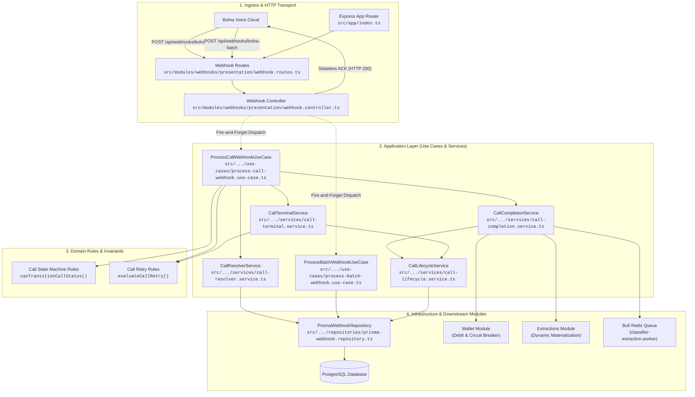
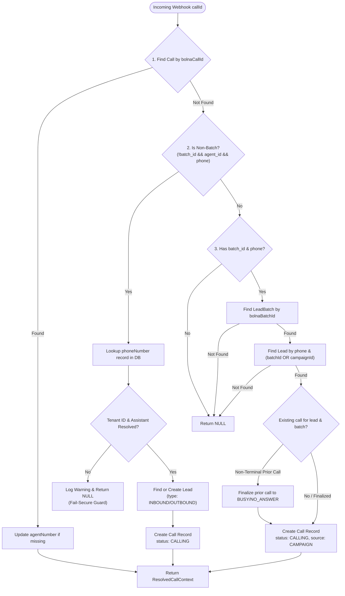
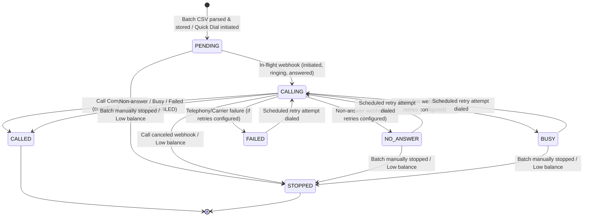
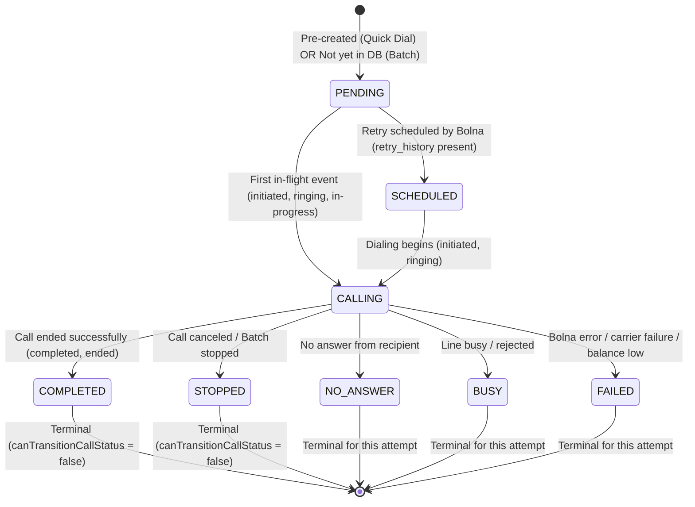
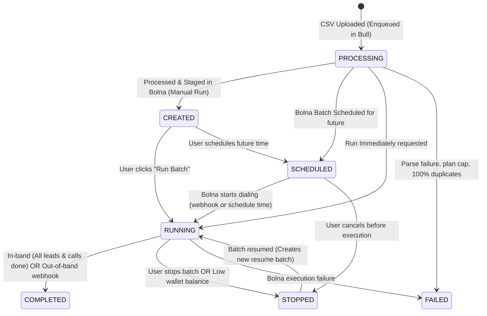
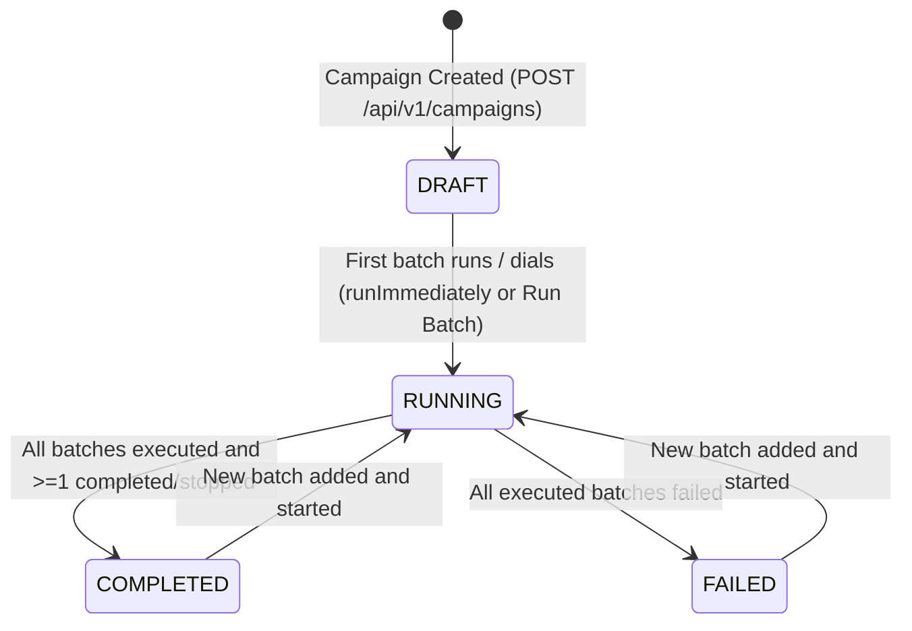
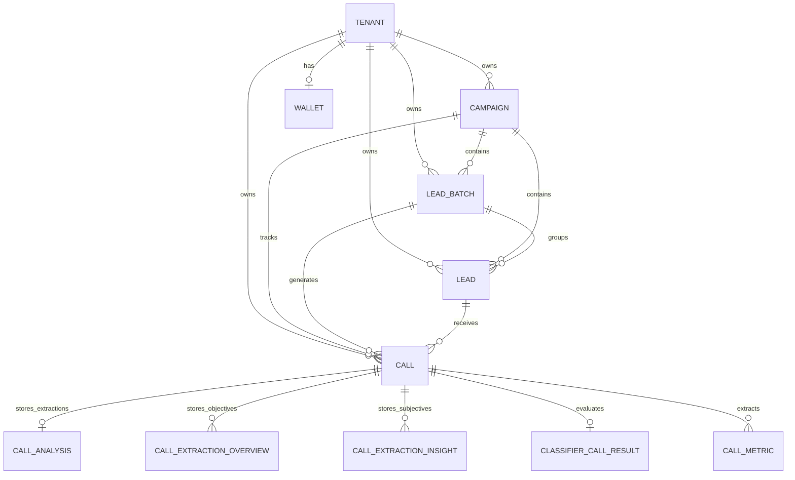

# Comprehensive Technical Audit: Bolna Webhook Event Processing & Lifecycle Management

**System:** Kooi AI Voice Agent & Lead Qualification Platform  
**Target Subsystem:** Bolna Telephony Webhook Ingestion, Event Processing & Multi-Entity Lifecycle Engine  
**Audit Date:** October 2026  
**Document Classification:** Internal Technical Report & Architecture Specification  

---

## 1. Executive Summary

This document presents a comprehensive, code-level architectural audit of Kooi's Bolna webhook event processing pipeline. The investigation traces how raw HTTP webhook events delivered by Bolna's AI voice calling infrastructure are received, authenticated, parsed, routed, and reflected across the four core lifecycle entities in Kooi: **Lead**, **Call**, **LeadBatch**, and **Campaign**.

### Primary Findings

1. **Dual-Path Endpoint Architecture:**
   Kooi exposes two distinct webhook ingress routes mounted at `/api/webhooks`:
   - `POST /api/webhooks/bolna`: Handles fine-grained per-call lifecycle events (`queued`, `initiated`, `ringing`, `in-progress`, `answered`, `completed`, `no-answer`, `busy`, `failed`, `stopped`, `scheduled`, `rescheduled`).
   - `POST /api/webhooks/bolna-batch`: Handles coarse-grained batch execution updates (`running`, `scheduled`, `completed`, `stopped`, `failed`).

2. **Asynchronous Fire-and-Forget Controller Pattern:**
   Both endpoints immediately return `HTTP 200 {"received": true}` to Bolna before invoking business logic on the Node.js event loop tick. While preventing Bolna HTTP client timeouts, this architectural choice creates significant failure blindspots: unhandled exceptions log to the local Winston transport, but Bolna considers the event acknowledged and never retries.

3. **Dynamic On-the-Fly Call & Lead Provisioning:**
   During batch campaigns, individual `Call` records are **not** pre-created when a batch is scheduled. Instead, `CallResolverService` dynamically provisions `Call` records upon receiving the first in-flight webhook (`initiated`, `ringing`, etc.) by looking up the lead via `(batch_id, phone)` or `(campaign_id, phone)`. For non-batch calls (Quick Dial or Inbound), it provisions both `Lead` and `Call` records dynamically using the caller ID mapped to tenant phone numbers.

4. **Multi-Attempt History in Single Call Aggregate:**
   When auto-retries are configured, Bolna executes retries under the same batch. Kooi tracks attempt history within a JSON column (`callHistory`) on the `Call` record, while also provisioning distinct `Call` rows for distinct Bolna execution IDs.

5. **Downstream Side-Effect Orchestration:**
   A successful call completion triggers a multi-stage downstream orchestration pipeline:
   - Dynamic prompt variable extraction materialization (`CallAnalysis`, `CallExtractionOverview`, `CallExtractionInsight`).
   - Real-time deterministic wallet debiting (integer paisa math with overdraft allowance and idempotency keys).
   - Automated tenant credit check and batch circuit-breaker (`StopBatchesOnInsufficientBalanceUseCase`).
   - Asynchronous Bull queue enqueuing for background JEV classifier extraction (`ClassifierCallResult`, `CallMetric`).
   - Upward batch and campaign completion reconciliation.

6. **Critical Vulnerabilities & Inconsistencies:**
   - **Authentication Bypass:** `verifyWebhookSecret` exists in `src/shared/middleware/verify-webhook.ts` but is **not mounted** on the webhook routes in `src/modules/webhooks/presentation/webhook.routes.ts`. Both webhook endpoints are completely public and unauthenticated.
   - **Dormant Aggregate Counters:** The method `incrementTerminalStats` in `PrismaWebhookRepository` is fully implemented to increment `calledLeads`, `completedLeads`, and `failedLeads` on `Campaign` and `LeadBatch`, but is **never invoked** anywhere in the webhook handling pipeline.
   - **Lead Status Semantic Distortion on Disabled Retries:** When batch/campaign retries are disabled, `evaluateCallRetry` marks non-answering, busy, and failed calls as `CALLED` on the lead record, obscuring call dispositions.
   - **Process Memory Failure Risk:** Because webhooks are processed in-memory after returning HTTP 200 without a durable ingest queue (like Redis/BullMQ), any Node.js process crash or container eviction during webhook processing results in permanent event loss.

---

## 2. Existing Bolna Webhook Architecture

The webhook subsystem follows Domain-Driven Design (DDD) and Clean Architecture principles, separated into Presentation, Application, Domain, and Infrastructure layers.



### Module Component Responsibilities

| Component | File Path | Core Responsibility |
|---|---|---|
| `buildWebhookRoutes` | `src/modules/webhooks/presentation/webhook.routes.ts` | Defines Express route definitions for `/bolna` and `/bolna-batch`. |
| `WebhookController` | `src/modules/webhooks/presentation/webhook.controller.ts` | Dispatches immediate 200 ACK and triggers asynchronous execution in background. |
| `ProcessCallWebhookUseCase` | `src/modules/webhooks/application/use-cases/process-call-webhook.use-case.ts` | Normalizes incoming status, handles in-flight events, retries, and delegates to services. |
| `ProcessBatchWebhookUseCase` | `src/modules/webhooks/application/use-cases/process-batch-webhook.use-case.ts` | Reconciles batch status from Bolna, handles batch-level stops, and checks campaign status. |
| `CallResolverService` | `src/modules/webhooks/application/services/call-resolver.service.ts` | Resolves existing `Call` records by `bolnaCallId` or dynamically creates new `Call`/`Lead` records. |
| `CallCompletionService` | `src/modules/webhooks/application/services/call-completion.service.ts` | Finalizes successful calls, extracts transcripts, handles billing, triggers classifier queue. |
| `CallTerminalService` | `src/modules/webhooks/application/services/call-terminal.service.ts` | Processes non-answered, busy, and failed calls; evaluates retry limits. |
| `CallLifecycleService` | `src/modules/webhooks/application/services/call-lifecycle.service.ts` | Reconciles batch and campaign completion states based on active leads, active calls, and retries. |
| `CallRetryRules` | `src/modules/webhooks/domain/rules/call-retry.rules.ts` | Pure domain calculation for `willRetry`, target lead status, and call disposition. |
| `CallStateMachineRules` | `src/modules/webhooks/domain/rules/call-state-machine.rules.ts` | Enforces state transition invariants, preventing out-of-order regression on terminal calls. |
| `PrismaWebhookRepository` | `src/modules/webhooks/infrastructure/repositories/prisma-webhook.repository.ts` | Encapsulates all Prisma database queries, updates, counts, and transactional operations. |

---

## 3. Webhook API Entry Point and Execution Flow

### Ingress Registration in Express Server

In [src/app/index.ts](file:///d:/BROCAMP/Ibrahim%20Thekkumkara/Lead%20Qualification/MVP/express-backend/src/app/index.ts#L80-L82):

```typescript
// ── 5. Bolna webhook routes (JSON body is fine here) ──────────
app.use("/api/webhooks", buildWebhookRoutes(container.webhooks.controller));
```

The route hierarchy is:
1. Base application mounts `/api/webhooks`.
2. `buildWebhookRoutes` attaches:
   - `POST /api/webhooks/bolna` -> `controller.bolna`
   - `POST /api/webhooks/bolna-batch` -> `controller.bolnaBatch`

### Body Parsing & Rate Limiting Bypass
- **Body Parser:** Mounted after `express.json({ limit: "10mb" })` and `express.urlencoded({ extended: true, limit: "10mb" })`. Payloads are parsed into standard JavaScript objects before reaching `WebhookController`.
- **Rate Limiting:** The global API limiter (`1500 requests per 15 min`) is registered at line 97 on `/api`, **after** `/api/webhooks`. Consequently, Bolna webhook endpoints are **not subject to the global API rate limiter**, preventing dropped webhook batches under high call volume.

### Authentication Status: Missing Guard
In `src/modules/webhooks/presentation/webhook.routes.ts`:
```typescript
/**
 * Public public endpoints for Bolna dashboard service integration.
 * Secured via verifyWebhookSecret header guard.
 *
 * Target mounting pattern: /webhooks
 */
export function buildWebhookRoutes(controller: WebhookController): Router {
  const router = Router();

  router.post("/bolna", controller.bolna);
  router.post("/bolna-batch", controller.bolnaBatch);

  return router;
}
```
> [!CAUTION]
> Despite the file docstring stating *"Secured via verifyWebhookSecret header guard"*, **no middleware is passed** to `router.post`. The `verifyWebhookSecret` middleware implemented in `src/shared/middleware/verify-webhook.ts` is completely omitted. Any external client on the internet can make unauthenticated HTTP POST requests to `/api/webhooks/bolna` and `/api/webhooks/bolna-batch` with arbitrary JSON payloads, manipulating lead, call, wallet, and campaign states.

### Execution Flow: Stateless Immediate ACK

In [src/modules/webhooks/presentation/webhook.controller.ts](file:///d:/BROCAMP/Ibrahim%20Thekkumkara/Lead%20Qualification/MVP/express-backend/src/modules/webhooks/presentation/webhook.controller.ts#L17-L46):

```typescript
bolna = async (req: Request<unknown, unknown, WebhookCallPayload>, res: Response): Promise<void> => {
  // Stateless response received immediately to prevent timeout blocks
  res.json({ received: true });

  try {
    await this.processCallWebhook.execute(req.body);
  } catch (err) {
    this.logger?.error("Per-call webhook processing error", err, {
      action: "webhook.call.processing_error",
    });
  }
};
```

#### Step-by-Step Execution Sequence:
1. Bolna HTTP Client issues `POST /api/webhooks/bolna`.
2. Express parses JSON body and invokes `controller.bolna`.
3. `res.json({ received: true })` writes headers and payload to the TCP socket immediately (`HTTP 200 OK`).
4. `await this.processCallWebhook.execute(req.body)` begins executing on the server's asynchronous task queue.
5. If `execute(req.body)` succeeds, all database changes, wallet debits, and queue messages complete silently.
6. If an error is thrown (e.g. `WebhookResolutionError`, DB deadlock, or external network error during wallet check), the `catch` block intercepts it and logs to Winston. Bolna does not receive an HTTP 500/422 status and will never retry the delivery.

---

## 4. Supported Bolna Events and Payload Mapping

### Per-Call Payload Structure (`WebhookCallPayload`)

The interface is defined in [src/modules/webhooks/application/dto/webhook.dto.ts](file:///d:/BROCAMP/Ibrahim%20Thekkumkara/Lead%20Qualification/MVP/express-backend/src/modules/webhooks/application/dto/webhook.dto.ts#L7-L52):

```typescript
export interface WebhookCallPayload {
  id?: string;
  execution_id?: string;
  run_id?: string;
  agent_id?: string;
  batch_id?: string;
  status: string;
  transcript?: string | null;
  summary?: string | null;
  conversation_duration?: number;
  total_cost?: number;
  error_message?: string | null;
  user_number?: string;
  agent_number?: string;
  extracted_data?: Record<string, any> | null;
  telephony_data?: {
    duration: number | string;
    recording_url: string;
    to_number: string;
    from_number: string;
    call_type?: string;
    hangup_reason?: string | null;
  };
  context_details?: {
    recipient_phone_number?: string;
  };
  recording_url?: string;
  duration?: number;
  created_at?: string;
  at?: string;
  scheduled_at?: string;
  messages?: WebhookMessage[];
  retry_count?: number;
  retry_history?: Array<{
    attempt?: number;
    status?: string;
    duration?: number;
    hangup_reason?: string;
    error_message?: string;
    created_at?: string;
    at?: string;
  }>;
  batch_run_details?: {
    retried: number;
  };
}
```

### Identifier Resolution Priority
The code identifies the Bolna Call ID using:
```typescript
const callId = payload.id ?? payload.execution_id ?? payload.run_id;
```
If all three fields are absent, the use case throws:
`WebhookResolutionError("Missing execution / call ID.")`.

### Event State Normalization
Bolna event names vary across versions (e.g., `call_completed`, `call-completed`, `in_progress`, `in-progress`).
Kooi normalizes all status strings with:
```typescript
const state = payload.status.toLowerCase().replace("_", "-");
```

### Supported Per-Call Events

| Raw Bolna Event(s) | Normalized `state` | Action / Handler Function | Conditions / Constraints |
|---|---|---|---|
| `queued` | `queued` | `break;` (No-op) | Ignored. No database records modified. |
| `scheduled`, `rescheduled` | `scheduled`, `rescheduled` | Inline switch block in `ProcessCallWebhookUseCase` | Handled when Bolna schedules an automated retry attempt. |
| `initiated`, `ringing`, `in-progress`, `answered` | `initiated`, `ringing`, `in-progress`, `answered` | Inline switch block in `ProcessCallWebhookUseCase` | Active in-flight call state. Updates call and lead to `CALLING`. |
| `completed`, `ended`, `call-completed` | `completed`, `ended`, `call-completed` | `CallCompletionService.handleCallCompleted` | Successful call conclusion. Extracts data, debits wallet, reconciles lifecycle. |
| `no-answer` | `no-answer` | `CallTerminalService.handleCallTerminal(call, "NO_ANSWER")` | Call rang out without answer. Evaluates retry rules. |
| `busy` | `busy` | `CallTerminalService.handleCallTerminal(call, "BUSY")` | Line was busy. Evaluates retry rules. |
| `failed`, `error`, `balance-low` | `failed`, `error`, `balance-low` | `CallTerminalService.handleCallTerminal(call, "FAILED")` | Telephony error, carrier rejection, or Bolna balance exhaustion. |
| `stopped`, `canceled` | `stopped`, `canceled` | `CallTerminalService.handleCallCanceled(call)` | Call terminated manually or via system abort. |

### Supported Batch Events (`WebhookBatchPayload`)

In [src/modules/webhooks/application/dto/webhook.dto.ts](file:///d:/BROCAMP/Ibrahim%20Thekkumkara/Lead%20Qualification/MVP/express-backend/src/modules/webhooks/application/dto/webhook.dto.ts#L54-L58):
```typescript
export interface WebhookBatchPayload {
  batch_id: string;
  state?: string;
  status?: string;
}
```
Normalization:
```typescript
const state = (payload.state ?? payload.status)?.toLowerCase();
```

| Raw Bolna State | Mapped `BatchStatus` | Action Taken |
|---|---|---|
| `running` | `RUNNING` | Updates `LeadBatch.status` to `RUNNING`. |
| `scheduled` | `SCHEDULED` | Updates status to `SCHEDULED` **only if** `leadBatch.scheduledAt` is already set. |
| `completed` | `COMPLETED` | Updates `LeadBatch.status` to `COMPLETED`, records `completedAt = now()`. Reconciles campaign. |
| `stopped` | `STOPPED` | Updates `LeadBatch.status` to `STOPPED`. Cascades `STOPPED` to in-flight calls and pending leads. |
| `failed` | `FAILED` | Updates `LeadBatch.status` to `FAILED`. Reconciles campaign. |

---

## 5. Event Processing and Handler Details

### 5.1 Call Resolution (`CallResolverService`)

When any per-call event arrives, `CallResolverService.resolveCallRecord(callId, payload)` executes a three-tier resolution strategy:



#### Resolution Logic Breakdown:
1. **Tier 1 (Direct Match):**
   Queries `prisma.call.findUnique({ where: { bolnaCallId: callId } })`. If found, patches `agentNumber` if not already set, and returns the context.
2. **Tier 2 (Non-Batch / Quick Dial / Inbound Fallback):**
   If `!payload.batch_id && payload.agent_id && phone`:
   - Inspects `payload.telephony_data?.call_type`: if `"inbound"`, sets `callType = "INBOUND"`, `callSource = "INBOUND"`. Otherwise `OUTBOUND`, `QUICK_DIAL`.
   - Resolves tenant ownership via `prisma.phoneNumber.findUnique({ where: { phoneNumber: agentNumber } })`.
   - **Fail-Secure Guard:** If no phone record exists or `targetTenantId` cannot be verified, it rejects the call and returns `null`. It never performs global unscoped assistant searches.
   - If lead exists, reuses it; if not, creates a new `Lead` with status `CALLING`.
   - Creates a new `Call` record with status `CALLING`.
3. **Tier 3 (Batch Dial Fallback):**
   If `payload.batch_id && phone`:
   - Looks up `LeadBatch` by `bolnaBatchId`.
   - Finds `Lead` by phone in that batch (or campaign).
   - Checks if an earlier call attempt exists for this `(leadId, batchId)`. If an earlier attempt exists in a non-terminal state (`SCHEDULED`, `CALLING`, `PENDING`), it updates that earlier call to `BUSY` or `NO_ANSWER`.
   - Creates a new `Call` record with `status: "CALLING"`, `source: "CAMPAIGN"`, `type: "OUTBOUND"`.
   - Updates lead status to `CALLING`.

---

### 5.2 Scheduled & Rescheduled Handler (`scheduled`, `rescheduled`)

Bolna fires this event when an auto-retry call is scheduled for a future time.
Location: `ProcessCallWebhookUseCase.execute` lines 39–133.

1. Calls `CallResolverService.resolveCallRecord(callId, payload)`.
2. Inspects `payload.retry_history`:
   ```typescript
   const lastRetry = payload.retry_history?.[payload.retry_history.length - 1];
   ```
3. Determines target call status:
   ```typescript
   const targetCallStatus = lastRetry?.status
     ? mapRetryStatusToCallStatus(lastRetry.status)
     : resolved.status === "PENDING"
       ? "SCHEDULED"
       : "NO_ANSWER";
   ```
4. **State Machine Invariant Check:**
   `canTransitionCallStatus(resolved.status, targetCallStatus)`
   If the call has already completed or reached terminal state, it logs a warning and exits.
5. Merges retry history into `updatedHistory` array, updating matching attempts or appending new ones.
6. Calls `webhookRepo.updateCallTerminalState(resolved.id, { status: targetCallStatus, duration, callHistory, endedAt })`.
7. Updates lead status:
   ```typescript
   if (lastRetry?.status) {
     const leadStatus = mapLastRetryToLeadStatus(lastRetry.status);
     await this.webhookRepo.updateLeadStatus(resolved.leadId, leadStatus);
   }
   ```
   *(Maps `busy` -> `BUSY`, `no-answer` -> `NO_ANSWER`, other -> `FAILED`)*.
8. Enforces batch & campaign continuity:
   - If `batchStatus` is not `STOPPED` or `FAILED`, updates batch status to `RUNNING`.
   - Updates campaign status to `RUNNING`.

---

### 5.3 In-Flight Events Handler (`initiated`, `ringing`, `in-progress`, `answered`)

Location: `ProcessCallWebhookUseCase.execute` lines 136–205.

1. Calls `CallResolverService.resolveCallRecord(callId, payload)`.
2. **State Transition Guard:**
   `canTransitionCallStatus(resolved.status, "CALLING")`
   If the call is already in a terminal state (`COMPLETED`, `STOPPED`, `NO_ANSWER`, `BUSY`, `FAILED`), this event is discarded as an out-of-order delivery.
3. Updates call record to `status: "CALLING"`.
4. Updates lead record to `status: "CALLING"`.
5. If associated with a batch:
   - If batch is not `STOPPED`, `COMPLETED`, or `FAILED`, updates batch status to `RUNNING` and sets `startedAt = new Date()`.
6. If associated with a campaign:
   - Updates campaign status to `RUNNING` and sets `startedAt = new Date()`.
7. **Proactive Balance Guard:**
   Fires `this.stopBatchesOnInsufficientBalance?.execute({ tenantId: resolved.tenantId })` asynchronously to stop other batches if the account balance has fallen below the safety threshold.

---

### 5.4 Call Completion Handler (`completed`, `ended`, `call-completed`)

Handled by `CallCompletionService.handleCallCompleted` in `src/modules/webhooks/application/services/call-completion.service.ts`:

1. **Transcript & Message Extraction:**
   - Maps `payload.messages` to standard format: `role: agent -> assistant`, `role: user -> user`.
   - Assembles `transcript`: uses `payload.transcript` or concatenates messages as `"assistant: ... \n user: ..."`.
2. **Duration Normalization:**
   Parses `payload.telephony_data?.duration` (handling string or integer), falling back to `conversation_duration` or `duration`.
3. **Dynamic Extractions Materialization:**
   If `payload.extracted_data` is present:
   - Invokes `MaterializeCallExtractionsUseCase.execute({ callId, tenantId, extractedData })`.
   - Maps variables against platform agent disposition definitions.
   - Upserts `CallAnalysis` record (`dynamicExtractions` and `extractionResult`).
   - Replaces objective items in `CallExtractionOverview`.
   - Replaces subjective free-text insights in `CallExtractionInsight`.
4. **Call History Array Maintenance:**
   Calculates `attemptNumber` from history length and `batch_run_details.retried`. Appends/updates entry with `status: "COMPLETED"`, duration, cost, and `hangup_reason`.
5. **Persist Terminal Call Record:**
   Updates `Call`:
   - `status = "COMPLETED"`
   - `transcript = transcript`
   - `transcriptMessages = messages`
   - `duration = duration`
   - `recording = payload.telephony_data.recording_url`
   - `cost = payload.total_cost`
   - `extractionResult = payload.extracted_data`
   - `endedAt = new Date()`
6. **Update Lead Record:**
   Updates `Lead`:
   - `status = "CALLED"`
7. **Deterministic Wallet Billing:**
   If `duration > 0`:
   - Calls `DebitWalletForCallUseCase.execute({ tenantId, callId, bolnaCallId, durationSec })`.
   - Calculates integer paisa cost using plan's rate, minimum seconds, and increment seconds.
   - Executes atomic DB transaction with `idempotencyKey: "call:${callId}:${bolnaCallId}"`.
   - Stores immutable audit snapshot in `Call`: `platformCost`, `billableSeconds`, `planVersionId`, `appliedRate`, `appliedMinSec`, `appliedIncrementSec`, `chargedAmount`.
8. **Credit Limit Circuit Breaker:**
   Calls `stopBatchesOnInsufficientBalance.execute({ tenantId })`.
9. **Async Classifier Extraction Enqueuing:**
   If `classifierQueue` and `transcript` exist:
   - Pushes job to Bull queue:
     ```typescript
     this.classifierQueue.add(
       { callId: call.id, tenantId: call.tenantId },
       { jobId: `classifier-${call.id}` }
     );
     ```
10. **Lifecycle Reconciliation:**
    Calls `CallLifecycleService.checkBatchAndCampaignCompletion(call)`.

---

### 5.5 Terminal Non-Completion Handler (`no-answer`, `busy`, `failed`, `error`, `balance-low`)

Handled by `CallTerminalService.handleCallTerminal` in `src/modules/webhooks/application/services/call-terminal.service.ts`:

1. Resolves retry config from `call.retryConfig ?? call.campaignDefaultRetryConfig`.
2. Updates `callHistory` array with the attempt's status, duration, error message, and hangup reason.
3. Checks if the parent batch is in `STOPPED` state (`isBatchStopped`).
4. Evaluates retry conditions via `evaluateCallRetry`:
   ```typescript
   const { willRetry, finalCallStatus, leadStatus } = evaluateCallRetry({
     isBatchStopped,
     retryConfig,
     currentAttempts: retriesCompleted,
     status, // "NO_ANSWER" | "BUSY" | "FAILED"
   });
   ```
5. Updates `Call` record:
   - `status = finalCallStatus` (`NO_ANSWER`, `BUSY`, or `FAILED`)
   - `duration = duration`
   - `cost = total_cost`
   - `recording = recording_url`
   - `callHistory = historyList`
   - `endedAt = new Date()`
6. Updates `Lead` record:
   - `status = leadStatus`
7. If `!willRetry` and associated with a campaign:
   - Calls `CallLifecycleService.checkBatchAndCampaignCompletion(call)`.

---

### 5.6 Call Canceled / Stopped Handler (`stopped`, `canceled`)

Handled by `CallTerminalService.handleCallCanceled` in `src/modules/webhooks/application/services/call-terminal.service.ts`:

1. If `call.status === "STOPPED"`, exits immediately (idempotency).
2. Appends `status: "STOPPED"` to `callHistory`.
3. Updates `Call`: `status = "STOPPED"`, `endedAt = new Date()`.
4. Updates `Lead`: `status = "STOPPED"`.
5. Calls `CallLifecycleService.checkBatchAndCampaignCompletion(call)`.

---

### 5.7 Batch Webhook Handler (`POST /api/webhooks/bolna-batch`)

Handled by `ProcessBatchWebhookUseCase` in `src/modules/webhooks/application/use-cases/process-batch-webhook.use-case.ts`:

1. Extracts `bolnaBatchId = payload.batch_id`.
2. Normalizes `state = (payload.state ?? payload.status)?.toLowerCase()`.
3. Finds batch via `findBatchIdByBolnaBatchId(bolnaBatchId)`.
4. Maps state to `BatchStatus`:
   `completed -> COMPLETED`, `stopped -> STOPPED`, `failed -> FAILED`, `running -> RUNNING`, `scheduled -> SCHEDULED`.
5. **Special State Protections:**
   - **Manual Stop Preservation:** If `leadBatch.status === "STOPPED"` and incoming event is `COMPLETED`, the update is ignored. This protects locally stopped batches so they can be resumed.
   - **Scheduling Guard:** If incoming state is `SCHEDULED` but `leadBatch.scheduledAt` is null, the event is ignored.
6. Updates batch status in DB:
   `updateBatchStatus(leadBatch.id, newStatus, newStatus === "COMPLETED" ? new Date() : undefined)`.
7. **Cascade Stop on STOPPED:**
   If `newStatus === "STOPPED"`, executes `stopBatchCallsAndLeads(leadBatch.id, "MANUAL")`:
   - Transitions all `SCHEDULED`, `CALLING`, and `PENDING` calls in the batch to `STOPPED`.
   - Transitions all `PENDING` and `CALLING` leads (and leads with stopped calls) in the batch to `STOPPED` with `stoppedReason = "MANUAL"`.
8. **Campaign Status Reconciliation:**
   - Fetches all batch statuses for `leadBatch.campaignId`.
   - Checks if any batch is `RUNNING`, `SCHEDULED`, or `PROCESSING`.
   - If no active batches remain, filters for executed batches (`status !== "CREATED"`).
   - If all executed batches are `FAILED`, sets campaign status to `FAILED`. Otherwise sets campaign status to `COMPLETED` with `completedAt = new Date()`.

---

## 6. Lead Lifecycle



### Lead Lifecycle Mechanics

1. **Association with Outbound Calls:**
   - In batch campaigns, `Lead` rows are created during Stage 2 of `BatchProcessingWorker` with `status: PENDING`, `batchId`, and `campaignId`.
   - When a call event arrives, `CallResolverService` matches the lead using phone and `batchId`.
   - The `Call` record holds a foreign key `leadId` referencing `Lead.id`.

2. **Lead Dispositions & Variables:**
   - When a call finishes, subjective and objective extractions extracted by Bolna's LLM are written to `CallAnalysis`, `CallExtractionOverview`, and `CallExtractionInsight`.
   - Individual lead fields (`Lead.status`) are updated to `CALLED`, while detailed dispositions remain associated with the call.

3. **Retry Attempts on Lead Status:**
   - When a call attempt fails (`no-answer`, `busy`, `failed`) and retries are enabled, `Lead.status` is updated to that failure disposition (`NO_ANSWER`, `BUSY`, or `FAILED`).
   - When Bolna subsequently fires `scheduled` or `rescheduled`, `ProcessCallWebhookUseCase` parses `payload.retry_history` and re-applies the last retry status (`NO_ANSWER`, `BUSY`, `FAILED`) to the lead.
   - When the retry attempt dials, the `initiated` or `ringing` webhook transitions the lead back to `CALLING`.
   - If the call eventually succeeds, the lead transitions to `CALLED`.

4. **The "Retries Disabled" Semantic Anomaly:**
   In [src/modules/webhooks/domain/rules/call-retry.rules.ts](file:///d:/BROCAMP/Ibrahim%20Thekkumkara/Lead%20Qualification/MVP/express-backend/src/modules/webhooks/domain/rules/call-retry.rules.ts#L51-L60):
   ```typescript
   let leadStatus: LeadStatus;
   if (retryEnabled) {
     leadStatus =
       status === "BUSY"
         ? "BUSY"
         : status === "FAILED"
           ? "FAILED"
           : "NO_ANSWER";
   } else {
     leadStatus = "CALLED";
   }
   ```
   > [!WARNING]
   > When `retryConfig.enabled` is false, any call that ends in `BUSY`, `NO_ANSWER`, or `FAILED` will set `Lead.status = "CALLED"`. This causes leads that were never answered or failed carrier routing to be marked identically to successfully qualified leads in the `Lead` table. (The true terminal disposition remains preserved on the `Call` entity, but the lead list view will display `CALLED`).

5. **Stop Reasons:**
   When a lead transitions to `STOPPED`, `Lead.stoppedReason` is populated with either:
   - `MANUAL`: Batch was manually stopped by tenant or admin.
   - `LOW_BALANCE`: Stopped automatically by wallet credit-limit check.

---

## 7. Call Lifecycle



### Call Lifecycle Mechanics

1. **When Call Records Are Created:**
   - **Quick Dial / API Outbound:** The `Call` record is pre-created with `status: PENDING` in `InitiateOutboundCallUseCase` before calling Bolna's API.
   - **Batch Campaigns:** `Call` records are **not** created when the batch is scheduled. The `Call` record is dynamically provisioned on the first incoming webhook (`initiated`, `ringing`, `in-progress`, etc.) by `CallResolverService.resolveCallRecord`.
   - **Subsequent Retries:** Each retry attempt that executes with a new Bolna execution ID gets its own provisioned `Call` row, while previous non-terminal attempts are finalized.

2. **Mapping Bolna Call Identifiers:**
   - The unique identifier from Bolna is stored in `Call.bolnaCallId` (which has a `@unique` index in PostgreSQL).
   - In incoming webhooks, Kooi checks `payload.id ?? payload.execution_id ?? payload.run_id`.

3. **Metadata Persistence:**
   Upon reaching `COMPLETED`, the following fields are persisted in `Call`:
   - `status`: `"COMPLETED"`
   - `duration`: Billable telephony duration in seconds (from `telephony_data.duration`).
   - `cost`: Total cost reported by Bolna.
   - `recording`: Recording audio URL from Bolna storage.
   - `transcript`: Text transcript.
   - `transcriptMessages`: JSON array of message objects.
   - `extractionResult`: Raw extracted key-value pairs.
   - `callHistory`: Complete array of all call attempts, durations, costs, and hangup reasons.
   - `endedAt`: ISO timestamp.
   - Cost Snapshot: `platformCost`, `billableSeconds`, `planVersionId`, `appliedRate`, `appliedMinSec`, `appliedIncrementSec`, `chargedAmount`.

4. **Out-of-Order Transition Guard:**
   Implemented in [src/modules/webhooks/domain/rules/call-state-machine.rules.ts](file:///d:/BROCAMP/Ibrahim%20Thekkumkara/Lead%20Qualification/MVP/express-backend/src/modules/webhooks/domain/rules/call-state-machine.rules.ts#L23-L45):
   ```typescript
   export function canTransitionCallStatus(
     currentStatus: CallStatus,
     nextStatus: CallStatus,
   ): boolean {
     if (currentStatus === nextStatus) return true;

     // Once completed or stopped, a call cannot regress to calling or scheduled
     if (currentStatus === "COMPLETED" || currentStatus === "STOPPED") {
       return false;
     }

     // Non-answer, busy, or failed cannot regress to in-flight or scheduled states
     if (
       (currentStatus === "NO_ANSWER" ||
         currentStatus === "BUSY" ||
         currentStatus === "FAILED") &&
       (nextStatus === "CALLING" || nextStatus === "PENDING" || nextStatus === "SCHEDULED")
     ) {
       return false;
     }

     return true;
   }
   ```
   If a network delay causes Bolna's `ringing` webhook to arrive after the `completed` webhook has already finished processing, `canTransitionCallStatus("COMPLETED", "CALLING")` returns `false`, preventing status regression.

---

## 8. Batch Lifecycle



### Batch Lifecycle Mechanics

1. **Batch Creation & Association:**
   - Created in `POST /api/v1/campaigns/:campaignId/batches/upload`.
   - A `LeadBatch` entity is inserted with `status: PROCESSING`.
   - The CSV is downloaded and processed by `BatchProcessingWorker`:
     - Deduplicates leads against existing campaign leads.
     - Inserts `Lead` records in DB (`batchId = leadBatch.id`, `campaignId = campaign.id`).
     - Uploads CSV buffer to Bolna API via `bolnaProvider.createBatch`.
     - Sets `bolnaBatchId` on `LeadBatch`.
     - If `runImmediately` or `scheduledAt`, calls `bolnaProvider.scheduleBatch`.

2. **Dual Batch Completion Paths:**
   A batch can transition to `COMPLETED` via two distinct mechanisms:
   - **In-Band Path (Per-Call Webhook):**
     Every time a call terminates, `CallLifecycleService.checkBatchAndCampaignCompletion` runs:
     ```typescript
     const [activeLeads, activeCalls, hasPendingRetries] = await Promise.all([
       this.webhookRepo.countActiveLeadsInBatch(call.batchId),
       this.webhookRepo.countActiveCallsInBatch(call.batchId),
       this.webhookRepo.hasPendingRetriesInBatch(call.batchId),
     ]);
     if (activeLeads === 0 && activeCalls === 0 && !hasPendingRetries) {
       await this.webhookRepo.updateBatchStatus(call.batchId, "COMPLETED", new Date());
     }
     ```
     - `countActiveLeadsInBatch`: Counts leads in `PENDING` or `CALLING`.
     - `countActiveCallsInBatch`: Counts calls in `SCHEDULED`, `CALLING`, or `PENDING`.
     - `hasPendingRetriesInBatch`: Inspects candidate leads in `BUSY`, `NO_ANSWER`, `FAILED` and checks if `l._count.calls < 1 + maxRetries`.
   - **Out-of-Band Path (Batch Webhook):**
     Bolna sends `POST /api/webhooks/bolna-batch` with `state: "completed"`. Handled by `ProcessBatchWebhookUseCase`, which transitions `LeadBatch.status` to `COMPLETED`.

3. **Batch Counters:**
   `LeadBatch` maintains counters in the repository representation, but does **not** persist `calledLeads`, `completedLeads`, or `failedLeads` in the PostgreSQL schema directly. Counter aggregates are computed on the fly via `prisma.lead.count` in `PrismaBatchRepository.findById`.

---

## 9. Campaign Lifecycle



### Campaign Lifecycle Mechanics

1. **Initiation:**
   Campaigns begin in `DRAFT` status with no leads. When a user runs a batch immediately or clicks "Run Batch", the campaign status updates to `RUNNING` with `startedAt = new Date()`.

2. **Progress Tracking:**
   Campaign progress is driven by its child batches and leads. Calls and leads carry both `campaignId` and `batchId`.

3. **Completion Determination:**
   Campaign completion is evaluated after any batch transition or after any terminal call:
   ```typescript
   const statuses = await this.webhookRepo.getAllBatchStatuses(campaignId);
   const hasActiveBatches = statuses.some(
     (s) => s === "RUNNING" || s === "SCHEDULED" || s === "PROCESSING"
   );

   if (!hasActiveBatches) {
     const executedBatches = statuses.filter((s) => s !== "CREATED");
     if (executedBatches.length > 0) {
       const allFailed = executedBatches.every((s) => s === "FAILED");
       const finalCampaignStatus = allFailed ? "FAILED" : "COMPLETED";

       await this.webhookRepo.updateCampaignStatus(campaignId, finalCampaignStatus, new Date());
     }
   }
   ```

4. **Divergence: Webhook Implementation vs Domain Rules:**
   - In `src/modules/campaigns/domain/rules/campaign-lifecycle.rules.ts` (line 34):
     ```typescript
     const hasUnstartedBatches = statuses.some((s) => s === "CREATED");
     if (hasUnstartedBatches) return "RUNNING";
     ```
     The domain rule states that if there are unstarted `CREATED` batches in a campaign, the campaign **must remain `RUNNING`**.
   - In `src/modules/webhooks/application/services/call-lifecycle.service.ts` (lines 43–50) and `ProcessBatchWebhookUseCase.ts` (lines 89–95):
     `CREATED` batches are deliberately filtered out (`statuses.filter((s) => s !== "CREATED")`). If Batch 1 finishes and Batch 2 is in `CREATED` status, the webhook handler marks the Campaign as `COMPLETED`.

---

## 10. Event-to-Entity Mapping Matrix

The following matrix documents the exact code changes triggered by each incoming webhook event across all entities:

| Bolna Event | Handler Function | Lead Changes | Call Changes | Batch Changes | Campaign Changes |
|---|---|---|---|---|---|
| `queued` | `ProcessCallWebhookUseCase.execute` | *Not Updated* | *Not Updated* | *Not Updated* | *Not Updated* |
| `scheduled` / `rescheduled` | `ProcessCallWebhookUseCase.execute` | Status set to `BUSY`, `NO_ANSWER`, or `FAILED` based on `lastRetry.status`. | If valid transition: Status updated to `mapRetryStatusToCallStatus(lastRetry.status)` or `SCHEDULED`; `callHistory` merged; `endedAt = now()`. | If not `STOPPED` or `FAILED`, status set to `RUNNING`. | Status set to `RUNNING`. |
| `initiated` / `ringing` / `in-progress` / `answered` | `ProcessCallWebhookUseCase.execute` & `CallResolverService` | If newly provisioned: Created with status `CALLING`. If existing: Status set to `CALLING`. | If newly provisioned: Created with status `CALLING`, `startedAt = now()`. If existing & not terminal: Status set to `CALLING`. | If not `STOPPED`, `COMPLETED`, or `FAILED`: Status set to `RUNNING`, `startedAt = now()`. | Status set to `RUNNING`, `startedAt = now()`. |
| `completed` / `ended` / `call-completed` | `CallCompletionService.handleCallCompleted` | Status set to `CALLED`. | Status set to `COMPLETED`; `transcript`, `transcriptMessages`, `duration`, `recording`, `cost`, `extractionResult`, `endedAt` persisted; `callHistory` updated; cost snapshot stored. | Reconciled via `checkBatchAndCampaignCompletion`. If active leads/calls=0 and no retries: Status set to `COMPLETED`, `completedAt = now()`. | Reconciled via `checkBatchAndCampaignCompletion`. If no active batches: Status set to `COMPLETED` (or `FAILED` if all failed), `completedAt = now()`. |
| `no-answer` | `CallTerminalService.handleCallTerminal` | If `retryEnabled`: Status set to `NO_ANSWER`. If `!retryEnabled`: Status set to `CALLED`. | Status set to `NO_ANSWER`; `duration`, `cost`, `recording`, `callHistory` updated; `endedAt = now()`. | If `!willRetry`: Reconciled via `checkBatchAndCampaignCompletion`. | If `!willRetry`: Reconciled via `checkBatchAndCampaignCompletion`. |
| `busy` | `CallTerminalService.handleCallTerminal` | If `retryEnabled`: Status set to `BUSY`. If `!retryEnabled`: Status set to `CALLED`. | Status set to `BUSY`; `duration`, `cost`, `recording`, `callHistory` updated; `endedAt = now()`. | If `!willRetry`: Reconciled via `checkBatchAndCampaignCompletion`. | If `!willRetry`: Reconciled via `checkBatchAndCampaignCompletion`. |
| `failed` / `error` / `balance-low` | `CallTerminalService.handleCallTerminal` | If `retryEnabled`: Status set to `FAILED`. If `!retryEnabled`: Status set to `CALLED`. | Status set to `FAILED`; `duration`, `cost`, `recording`, `callHistory` updated; `endedAt = now()`. | If `!willRetry`: Reconciled via `checkBatchAndCampaignCompletion`. | If `!willRetry`: Reconciled via `checkBatchAndCampaignCompletion`. |
| `stopped` / `canceled` | `CallTerminalService.handleCallCanceled` | Status set to `STOPPED`. | Status set to `STOPPED`; `callHistory` updated; `endedAt = now()`. | Reconciled via `checkBatchAndCampaignCompletion`. | Reconciled via `checkBatchAndCampaignCompletion`. |
| `bolna-batch` (`running`) | `ProcessBatchWebhookUseCase.execute` | *Not Updated* | *Not Updated* | Status set to `RUNNING`. | *Not Updated* |
| `bolna-batch` (`scheduled`) | `ProcessBatchWebhookUseCase.execute` | *Not Updated* | *Not Updated* | If `scheduledAt` exists: Status set to `SCHEDULED`. | *Not Updated* |
| `bolna-batch` (`completed`) | `ProcessBatchWebhookUseCase.execute` | *Not Updated* | *Not Updated* | If not currently `STOPPED`: Status set to `COMPLETED`, `completedAt = now()`. | If no active batches remain: Status set to `COMPLETED` (or `FAILED`), `completedAt = now()`. |
| `bolna-batch` (`stopped`) | `ProcessBatchWebhookUseCase.execute` | Active/pending leads in batch transitioned to `STOPPED` with `stoppedReason = MANUAL`. | Active calls in batch (`SCHEDULED`, `CALLING`, `PENDING`) transitioned to `STOPPED`, `endedAt = now()`. | Status set to `STOPPED`. | If no active batches remain: Status set to `COMPLETED` (or `FAILED`), `completedAt = now()`. |
| `bolna-batch` (`failed`) | `ProcessBatchWebhookUseCase.execute` | *Not Updated* | *Not Updated* | Status set to `FAILED`. | If no active batches remain: Status set to `COMPLETED` (or `FAILED`), `completedAt = now()`. |

---

## 11. Database Models and Status Transitions

### Prisma Schema Definitions

```prisma
enum CampaignStatus {
  DRAFT
  RUNNING
  COMPLETED
  FAILED
}

enum BatchStatus {
  PROCESSING
  CREATED
  SCHEDULED
  RUNNING
  STOPPED
  COMPLETED
  FAILED
}

enum LeadStatus {
  PENDING
  CALLING
  CALLED
  NO_ANSWER
  BUSY
  FAILED
  STOPPED
}

enum LeadStopReason {
  LOW_BALANCE
  MANUAL
}

enum CallStatus {
  PENDING
  CALLING
  COMPLETED
  FAILED
  NO_ANSWER
  BUSY
  STOPPED
  SCHEDULED
}

enum CallType {
  OUTBOUND
  INBOUND
}

enum CallSource {
  CAMPAIGN
  INBOUND
  QUICK_DIAL
}
```

### Entity Relational Model



### Transaction Boundaries

| Operation | Implementation | Transaction Boundary |
|---|---|---|
| Batch Manual/Webhook Stop | `stopBatchCallsAndLeads` | `prisma.$transaction` (Atomic call and lead updates) |
| Insufficient Balance Batch Stop | `stopBatchesOnInsufficientBalance` | `prisma.$transaction` (Atomic batch, call, and lead updates) |
| Call Wallet Debit | `debitWalletForCall` | `prisma.$transaction` (Atomic balance debit and transaction ledger insertion) |
| Dynamic Extractions Materialization | `replaceExtractionOverview` / `replaceExtractionInsights` | `prisma.$transaction` (Atomic deleteMany + createMany) |
| Call Completion Ingestion | `handleCallCompleted` | **Non-transactional**. Executes sequential queries: `updateCallTerminalState`, `updateLeadStatus`, `debitWallet`, `classifierQueue.add`, `checkBatchAndCampaignCompletion`. |
| In-Flight Call Update | `ProcessCallWebhookUseCase.execute` | **Non-transactional**. Sequential independent updates to Call, Lead, Batch, and Campaign. |

---

## 12. Error Handling, Retries, and Idempotency

### Webhook Ingress Error Isolation
In `WebhookController`:
```typescript
res.json({ received: true });
try {
  await this.processCallWebhook.execute(req.body);
} catch (err) {
  this.logger?.error("Per-call webhook processing error", err, { ... });
}
```
- **Strengths:** Eliminates Bolna client timeout errors on slow DB writes or downstream queue latency.
- **Weaknesses:** Because HTTP 200 is already sent, Bolna never receives an error response. If a network blip occurs during database writing, or if Prisma encounters a connection pool timeout, the event fails silently and is never re-transmitted.

### Idempotency Safeguards

1. **Wallet Debit Idempotency:**
   Guarded by a unique idempotency key:
   ```typescript
   idempotencyKey: `call:${input.callId}:${input.bolnaCallId}`
   ```
   If Bolna delivers duplicate `completed` webhooks, the wallet module ignores the second debit request.

2. **Classifier Queue Idempotency:**
   Guarded by deterministic Bull job IDs:
   ```typescript
   jobId: `classifier-${call.id}`
   ```
   Duplicate completions will not enqueue duplicate background extraction jobs.

3. **Call History Array Deduping:**
   In `CallCompletionService` and `CallTerminalService`:
   ```typescript
   const existingIdx = historyList.findIndex(
     (h) => h.attempt === attemptNumber || (bolnaCallId && h.bolnaCallId === String(bolnaCallId))
   );
   if (existingIdx >= 0) {
     historyList[existingIdx] = historyEntry;
   } else {
     historyList.push(historyEntry);
   }
   ```
   If a webhook for the same attempt is delivered twice, it updates the existing attempt object rather than appending a duplicate entry.

4. **Missing Ingress Idempotency Key:**
   There is no webhook delivery log or deduplication cache on raw webhook request bodies. If Bolna fires duplicate `initiated` webhooks concurrently, race conditions can occur.

---

## 13. Event Ordering and Concurrency Handling

### Out-of-Order Delivery Mitigation
Bolna webhooks travel over the public internet and may arrive out of order (e.g. `ringing` arrives 2 seconds after `completed`).
- **Call Entity Guard:** `canTransitionCallStatus(current, next)` guarantees that a call in `COMPLETED`, `STOPPED`, `NO_ANSWER`, `BUSY`, or `FAILED` will never regress to `CALLING` or `SCHEDULED`.
- **Batch Entity Guard:** In `ProcessBatchWebhookUseCase`, a manually `STOPPED` batch will never be overwritten by a delayed `COMPLETED` webhook.
- **Vulnerability:** `canTransitionBatchStatus` (defined in `batch-status.rules.ts`) is **not** imported or used in `ProcessBatchWebhookUseCase`. An out-of-order `RUNNING` webhook can overwrite a `COMPLETED` batch.

### Concurrency & Race Conditions
1. **Simultaneous Call Completion:**
   When a batch has 50 concurrent calls, multiple calls may finish in the same millisecond. Each handler runs:
   ```typescript
   const [activeLeads, activeCalls, hasPendingRetries] = await Promise.all([...]);
   if (activeLeads === 0 && activeCalls === 0 && !hasPendingRetries) {
     await this.webhookRepo.updateBatchStatus(call.batchId, "COMPLETED", new Date());
   }
   ```
   Because there is no row-level locking (`SELECT FOR UPDATE`) or distributed lock (Redis/Redlock), multiple concurrent webhook executions can evaluate this block simultaneously, issuing duplicate `updateBatchStatus` and `updateCampaignStatus` queries.
2. **Concurrent Provisioning:**
   If Bolna fires `initiated` and `ringing` in parallel before the call record exists in the DB, both requests can execute Tier 3 of `CallResolverService` concurrently, attempting to insert duplicate calls for the same lead.

---

## 14. Identified Gaps, Risks, and Inconsistencies

### Priority 1: Critical Risks (Immediate Security / Data Integrity Impact)

1. **Unauthenticated Public Webhook Endpoints (`verifyWebhookSecret` Omitted)**
   - **File:** [src/modules/webhooks/presentation/webhook.routes.ts](file:///d:/BROCAMP/Ibrahim%20Thekkumkara/Lead%20Qualification/MVP/express-backend/src/modules/webhooks/presentation/webhook.routes.ts#L13-L14)
   - **Issue:** The routes `POST /bolna` and `POST /bolna-batch` have no authentication middleware attached. The middleware `verifyWebhookSecret` in `src/shared/middleware/verify-webhook.ts` is unused.
   - **Impact:** Any entity on the internet can forge webhook requests to transition calls, alter lead states, manipulate campaign progress, debit tenant wallets, or stop active batches.

2. **Fire-and-Forget Loss on Server Restarts or Unhandled Failures**
   - **File:** [src/modules/webhooks/presentation/webhook.controller.ts](file:///d:/BROCAMP/Ibrahim%20Thekkumkara/Lead%20Qualification/MVP/express-backend/src/modules/webhooks/presentation/webhook.controller.ts#L22-L30)
   - **Issue:** `res.json({ received: true })` is sent before `execute()` completes. If the Node.js process crashes, runs out of memory, or restarts during `execute()`, the webhook data is lost forever because Bolna received HTTP 200 and will not retry.

### Priority 2: Major Architectural Inconsistencies

3. **Dead Code: Uncalled Terminal Counter Increments**
   - **File:** [src/modules/webhooks/infrastructure/repositories/prisma-webhook.repository.ts](file:///d:/BROCAMP/Ibrahim%20Thekkumkara/Lead%20Qualification/MVP/express-backend/src/modules/webhooks/infrastructure/repositories/prisma-webhook.repository.ts#L338-L360)
   - **Issue:** `incrementTerminalStats(campaignId, batchId, status)` is fully implemented to update `calledLeads`, `completedLeads`, and `failedLeads` on `Campaign` and `LeadBatch`. However, it is **never called** by `CallCompletionService`, `CallTerminalService`, or `ProcessCallWebhookUseCase`.
   - **Impact:** Persistent counter columns on database records remain un-incremented by real-time webhooks, requiring expensive dynamic counting (`COUNT(*)`) across tables.

4. **Lead Status Distortion on Disabled Retries**
   - **File:** [src/modules/webhooks/domain/rules/call-retry.rules.ts](file:///d:/BROCAMP/Ibrahim%20Thekkumkara/Lead%20Qualification/MVP/express-backend/src/modules/webhooks/domain/rules/call-retry.rules.ts#L58-L60)
   - **Issue:** When retries are disabled (`!retryEnabled`), `evaluateCallRetry` maps `BUSY`, `NO_ANSWER`, and `FAILED` calls to `leadStatus = "CALLED"`.
   - **Impact:** Leads that were never reached or failed telephony connection appear as `CALLED` in lead lists, conflating unreachable leads with qualified leads.

5. **Campaign Completion Semantic Discrepancy**
   - **Files:** [src/modules/campaigns/domain/rules/campaign-lifecycle.rules.ts](file:///d:/BROCAMP/Ibrahim%20Thekkumkara/Lead%20Qualification/MVP/express-backend/src/modules/campaigns/domain/rules/campaign-lifecycle.rules.ts#L34-L37) vs [src/modules/webhooks/application/services/call-lifecycle.service.ts](file:///d:/BROCAMP/Ibrahim%20Thekkumkara/Lead%20Qualification/MVP/express-backend/src/modules/webhooks/application/services/call-lifecycle.service.ts#L50)
   - **Issue:** The domain rule mandates that a campaign with unstarted `CREATED` batches must remain `RUNNING`. However, `CallLifecycleService` explicitly ignores `CREATED` batches, marking the campaign as `COMPLETED` when the active batch finishes.

### Priority 3: Moderate Robustness Deficiencies

6. **Missing Runtime Schema Validation on Webhook Ingress**
   - **Files:** `src/modules/webhooks/presentation/webhook.controller.ts`
   - **Issue:** Incoming request bodies are directly typed with TypeScript generics (`Request<..., WebhookCallPayload>`) without runtime validation (e.g. Zod schema validation). Malformed payloads cause runtime errors in use-case execution.

7. **Missing Batch State Machine Invariant Checking**
   - **File:** [src/modules/webhooks/application/use-cases/process-batch-webhook.use-case.ts](file:///d:/BROCAMP/Ibrahim%20Thekkumkara/Lead%20Qualification/MVP/express-backend/src/modules/webhooks/application/use-cases/process-batch-webhook.use-case.ts#L37-L56)
   - **Issue:** `canTransitionBatchStatus` (defined in `batch-status.rules.ts`) is ignored. Only manual stop and scheduled flags are checked. A late `RUNNING` webhook can overwrite a `COMPLETED` batch status.

8. **Non-Transactional Completion Pipeline**
   - **File:** [src/modules/webhooks/application/services/call-completion.service.ts](file:///d:/BROCAMP/Ibrahim%20Thekkumkara/Lead%20Qualification/MVP/express-backend/src/modules/webhooks/application/services/call-completion.service.ts#L118-L212)
   - **Issue:** Call completion executes database updates, wallet debits, and lifecycle checks in separate non-transactional statements. If an error occurs midway, partial state updates (e.g. call marked completed but wallet not debited) can persist.

---

## 15. Recommendations for Future Improvements

### Priority 0: Security & Resilience (Must Fix)
1. **Mount Authentication Guard:**
   Attach `verifyWebhookSecret(logger)` to `router.post("/bolna")` and `router.post("/bolna-batch")` in `webhook.routes.ts`. Configure Bolna webhook settings with the matching `x-webhook-secret` header.
2. **Durable Ingress Queue (Buffer Architecture):**
   Replace the in-memory execution in `WebhookController` with a persistent Redis BullMQ queue (e.g. `webhook-call-queue`, `webhook-batch-queue`). The controller writes the raw payload to Redis, immediately returns `HTTP 200 {"received": true}`, and worker processes consume the queue with automatic retry policies (exponential backoff) on failure.

### Priority 1: Data Integrity & Consistency
3. **Harmonize Lead Statuses:**
   Refactor `call-retry.rules.ts` so that when `!retryEnabled`, `leadStatus` reflects the true disposition (`NO_ANSWER`, `BUSY`, or `FAILED`) rather than forcing `CALLED`.
4. **Reconcile Aggregate Counters:**
   Call `incrementTerminalStats` within `CallCompletionService` and `CallTerminalService` to ensure `calledLeads`, `completedLeads`, and `failedLeads` stay synchronized on `Campaign` and `LeadBatch`.
5. **Runtime Payload Validation:**
   Add Zod schemas for `WebhookCallPayload` and `WebhookBatchPayload` using `validateBody(schema)` middleware before invoking controllers.

### Priority 2: Concurrency & State Machine Hardening
6. **Distributed Lock on Batch Completion:**
   Wrap `checkBatchAndCampaignCompletion` in a Redis distributed lock keyed by `lock:batch-completion:${batchId}` to eliminate race conditions when dozens of calls complete simultaneously.
7. **Adopt Batch State Machine Invariants:**
   Import and enforce `canTransitionBatchStatus` in `ProcessBatchWebhookUseCase` before writing batch status changes to the database.
8. **Align Campaign Lifecycle Logic:**
   Harmonize the handling of `CREATED` batches between `campaign-lifecycle.rules.ts` and `CallLifecycleService`.

---

## 16. Relevant Source Files and Code References

### Webhooks Module
- [src/modules/webhooks/presentation/webhook.routes.ts](file:///d:/BROCAMP/Ibrahim%20Thekkumkara/Lead%20Qualification/MVP/express-backend/src/modules/webhooks/presentation/webhook.routes.ts): Route registration for `/bolna` and `/bolna-batch`.
- [src/modules/webhooks/presentation/webhook.controller.ts](file:///d:/BROCAMP/Ibrahim%20Thekkumkara/Lead%20Qualification/MVP/express-backend/src/modules/webhooks/presentation/webhook.controller.ts): Controller actions with immediate 200 ACK.
- [src/modules/webhooks/application/dto/webhook.dto.ts](file:///d:/BROCAMP/Ibrahim%20Thekkumkara/Lead%20Qualification/MVP/express-backend/src/modules/webhooks/application/dto/webhook.dto.ts): DTO interfaces (`WebhookCallPayload`, `WebhookBatchPayload`).
- [src/modules/webhooks/application/use-cases/process-call-webhook.use-case.ts](file:///d:/BROCAMP/Ibrahim%20Thekkumkara/Lead%20Qualification/MVP/express-backend/src/modules/webhooks/application/use-cases/process-call-webhook.use-case.ts): Main per-call webhook router and state switch.
- [src/modules/webhooks/application/use-cases/process-batch-webhook.use-case.ts](file:///d:/BROCAMP/Ibrahim%20Thekkumkara/Lead%20Qualification/MVP/express-backend/src/modules/webhooks/application/use-cases/process-batch-webhook.use-case.ts): Batch webhook handler and status updater.
- [src/modules/webhooks/application/services/call-resolver.service.ts](file:///d:/BROCAMP/Ibrahim%20Thekkumkara/Lead%20Qualification/MVP/express-backend/src/modules/webhooks/application/services/call-resolver.service.ts): Dynamic call and lead resolution/provisioning logic.
- [src/modules/webhooks/application/services/call-completion.service.ts](file:///d:/BROCAMP/Ibrahim%20Thekkumkara/Lead%20Qualification/MVP/express-backend/src/modules/webhooks/application/services/call-completion.service.ts): Handles completed calls, billing, and queue enqueuing.
- [src/modules/webhooks/application/services/call-terminal.service.ts](file:///d:/BROCAMP/Ibrahim%20Thekkumkara/Lead%20Qualification/MVP/express-backend/src/modules/webhooks/application/services/call-terminal.service.ts): Handles failed/busy/no-answer calls and retries.
- [src/modules/webhooks/application/services/call-lifecycle.service.ts](file:///d:/BROCAMP/Ibrahim%20Thekkumkara/Lead%20Qualification/MVP/express-backend/src/modules/webhooks/application/services/call-lifecycle.service.ts): Reconciles batch and campaign completion.
- [src/modules/webhooks/domain/rules/call-retry.rules.ts](file:///d:/BROCAMP/Ibrahim%20Thekkumkara/Lead%20Qualification/MVP/express-backend/src/modules/webhooks/domain/rules/call-retry.rules.ts): Evaluates retry criteria and maps retry statuses.
- [src/modules/webhooks/domain/rules/call-state-machine.rules.ts](file:///d:/BROCAMP/Ibrahim%20Thekkumkara/Lead%20Qualification/MVP/express-backend/src/modules/webhooks/domain/rules/call-state-machine.rules.ts): Out-of-order transition invariants.
- [src/modules/webhooks/domain/errors/webhook.errors.ts](file:///d:/BROCAMP/Ibrahim%20Thekkumkara/Lead%20Qualification/MVP/express-backend/src/modules/webhooks/domain/errors/webhook.errors.ts): `WebhookResolutionError`.
- [src/modules/webhooks/infrastructure/repositories/prisma-webhook.repository.ts](file:///d:/BROCAMP/Ibrahim%20Thekkumkara/Lead%20Qualification/MVP/express-backend/src/modules/webhooks/infrastructure/repositories/prisma-webhook.repository.ts): Concrete DB repository for webhooks.
- [src/modules/webhooks/container.ts](file:///d:/BROCAMP/Ibrahim%20Thekkumkara/Lead%20Qualification/MVP/express-backend/src/modules/webhooks/container.ts): Dependency injection wiring for webhooks.

### Related Core Subsystems
- [src/shared/middleware/verify-webhook.ts](file:///d:/BROCAMP/Ibrahim%20Thekkumkara/Lead%20Qualification/MVP/express-backend/src/shared/middleware/verify-webhook.ts): Unmounted webhook secret verification middleware.
- [src/shared/types/bolna.types.ts](file:///d:/BROCAMP/Ibrahim%20Thekkumkara/Lead%20Qualification/MVP/express-backend/src/shared/types/bolna.types.ts): Upstream Bolna payload schemas and types.
- [src/shared/config/external/bolna/bolna.client.ts](file:///d:/BROCAMP/Ibrahim%20Thekkumkara/Lead%20Qualification/MVP/express-backend/src/shared/config/external/bolna/bolna.client.ts): Bolna API client implementation.
- [src/modules/batches/infrastructure/jobs/batch-processing.worker.ts](file:///d:/BROCAMP/Ibrahim%20Thekkumkara/Lead%20Qualification/MVP/express-backend/src/modules/batches/infrastructure/jobs/batch-processing.worker.ts): Worker that provisions leads and registers batch webhook URL.
- [src/modules/batches/domain/entities/batch-status.rules.ts](file:///d:/BROCAMP/Ibrahim%20Thekkumkara/Lead%20Qualification/MVP/express-backend/src/modules/batches/domain/entities/batch-status.rules.ts): Batch status transition rules.
- [src/modules/campaigns/domain/rules/campaign-lifecycle.rules.ts](file:///d:/BROCAMP/Ibrahim%20Thekkumkara/Lead%20Qualification/MVP/express-backend/src/modules/campaigns/domain/rules/campaign-lifecycle.rules.ts): Domain rules for campaign completion.
- [src/modules/wallet/application/use-cases/debit-wallet.use-case.ts](file:///d:/BROCAMP/Ibrahim%20Thekkumkara/Lead%20Qualification/MVP/express-backend/src/modules/wallet/application/use-cases/debit-wallet.use-case.ts): Deterministic call billing use case.
- [src/modules/wallet/application/use-cases/stop-batches-on-insufficient-balance.use-case.ts](file:///d:/BROCAMP/Ibrahim%20Thekkumkara/Lead%20Qualification/MVP/express-backend/src/modules/wallet/application/use-cases/stop-batches-on-insufficient-balance.use-case.ts): Credit check circuit breaker.
- [src/modules/extractions/application/use-cases/materialize-call-extractions.use-case.ts](file:///d:/BROCAMP/Ibrahim%20Thekkumkara/Lead%20Qualification/MVP/express-backend/src/modules/extractions/application/use-cases/materialize-call-extractions.use-case.ts): Parses and materializes dynamic prompt extractions.
- [src/modules/classifier/infrastructure/jobs/classifier-extraction.worker.ts](file:///d:/BROCAMP/Ibrahim%20Thekkumkara/Lead%20Qualification/MVP/express-backend/src/modules/classifier/infrastructure/jobs/classifier-extraction.worker.ts): Background Bull worker for AI transcript evaluations.
- [prisma/schema.prisma](file:///d:/BROCAMP/Ibrahim%20Thekkumkara/Lead%20Qualification/MVP/express-backend/prisma/schema.prisma): Database schema definition for PostgreSQL entities.

